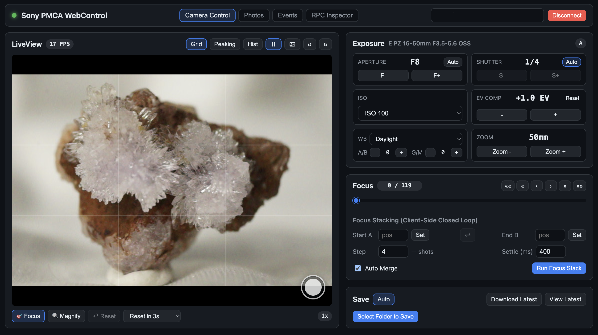

# Sony PMCA WebControl (`sony-pmca-webcontrol`)

An open-source **Sony Imaging Edge alternative** and **Wi-Fi tethering** solution for PlayMemories-capable Sony Alpha / Cyber-shot cameras (such as **a6000, a6300, a6500, a5100, a7 II, a7R II, a7S II, RX100 III–V, RX10 II–III**). Unlike Sony's official app, it joins your home Wi-Fi LAN directly without disconnecting from the internet and adds **MJPEG Live View, device-side event-driven closed-loop Focus/Exposure/Zoom control, automated Focus Bracketing / Focus Stacking, and a reflective HTTP JSON-RPC API**.

## Quick Start (Prebuilt Releases)

You don't need Android Studio or Node.js to try it out:
1. Download the prebuilt `sony-pmca-webcontrol-debug-1.0.0.apk` (and optionally the single-file `index.html`) from **GitHub Releases** or the latest **GitHub Actions** run artifacts.
2. Flash the `.apk` to your camera via USB using [Sony-PMCA-RE (`pmca-console`)](https://github.com/ma1co/Sony-PMCA-RE) (see [docs/USER_GUIDE.md](./docs/USER_GUIDE.md) for step-by-step instructions).
3. Launch **Sony PMCA WebControl** in your camera's *Application* menu and open `http://<camera-ip>:8080` (or port `80` if displayed on screen) directly in your browser — it serves the pre-compressed React UI from the camera itself, including browser-download **Auto-Save**. Optionally run `host-server/` over HTTPS for direct local-folder Auto-Save (`showDirectoryPicker`) & **OpenFocus** stack merging.

## Key Features

* **Direct Home Wi-Fi & On-Camera HUD**: Connects directly to your existing Wi-Fi router (no need to disconnect your Mac or iPad from the internet to join an ad-hoc camera hotspot) and displays its LAN IP/port (`80` or `8080`), battery %, exposure/focal-length telemetry, and MF scale bar on the camera LCD (press **UP** or **OK** to toggle the HUD overlay).
* **Universal Reflective RPC & High-Level Closed-Loop APIs (`POST /api/call` & `GET /api/describe`)**: Exposes Sony's underlying `CameraEx`, `ParametersModifier`, `Camera.Parameters`, and whitelisted Scalar static/system classes over HTTP with automatic JSON ↔ Java conversion and batching, plus device-side `highlevel` closed-loop setters (`setFocusPosition`, `autoFocusAt`, `setAperture`, `setShutterSpeed`, `setZoomPosition`) with zoom-calibrated focus step prediction.
* **Real-Time SSE Event Stream & MJPEG Live View**: Hardware-accelerated 640px JPEG preview stream (`/api/liveview.mjpeg` and `/api/liveview.jpg`), real-time Server-Sent Events (`/api/events/stream`, with `/api/events` long-polling compatibility), and state snapshots (`/api/state`).
* **Modern React Web Client (`web-client/`)**: Single-file React + TypeScript app featuring live **Focus Peaking**, rule-of-thirds **Grid**, luma **Histogram**, 90° rotation (`↺/↻`), pause/resume, selectable MJPEG/JPEG transport, click-to-**Focus** (touch AF) & **Magnify** (`5.9x / 11.7x` with configurable Auto-Reset), **Exposure** controls (Aperture/Shutter `Auto` toggles, ISO, EV Comp with `Reset`, **White Balance** presets / Color Temp `K` / `A/B` & `G/M` shift, live focal length & tap/hold Power Zoom), **Focus** steppers + closed-loop position slider + automated **Focus Stacking** (`A ⇄ B` swap & `Settle (ms)`), **Save** panel (`Auto`, `Download Latest`, `View Latest`), SD card **Photos** browser, **Events** log, interactive **RPC Inspector**, and header **Connect / Disconnect**.
* **Optional Host Companion Backend (`host-server/`)**: Zero-dependency Python 3 HTTPS server that proxies `/api/*` to the camera, unlocks browser `showDirectoryPicker` silent **Auto-Save** directly into a chosen local folder over LAN HTTPS, and integrates with [Xinzhe99/OpenFocus](https://github.com/Xinzhe99/OpenFocus) (**Auto Merge**) to automatically align/merge focus stacks on the host and save only the single resulting `.jpg`.
* **Pre-Compressed In-Camera Web UI**: Opening `http://<camera-ip>:8080` directly in any modern browser serves the camera-embedded conditional build of `web-client/` (`assets/index.html.gzip`, ~90 KB over Wi-Fi via `Content-Encoding: gzip`), retaining **Save / Auto-Save** (via browser downloads) and omitting only host-only **Auto Merge** (OpenFocus).

## Requirements

### 1. Compatible Sony Cameras
* **Full Support** (Live View + Remote MF Stepping + Automated Focus Bracketing + Exposure Control; requires Scalar Android Platform $\ge 2.3$):
  * **APS-C E-mount**: `ILCE-5100` (a5100), `ILCE-6000` (a6000), `ILCE-6300` (a6300), `ILCE-6500` (a6500)
  * **Full-Frame E-mount**: `ILCE-7M2` (a7 II), `ILCE-7RM2` (a7R II), `ILCE-7SM2` (a7S II), and `ILCE-7` / `ILCE-7R` / `ILCE-7S` updated to the latest firmware
  * **Fixed-Lens Cyber-shot**: `DSC-RX100M3` (RX100 III), `DSC-RX100M4` (RX100 IV), `DSC-RX100M5` (RX100 V), `DSC-RX10M2` (RX10 II), `DSC-RX10M3` (RX10 III), `DSC-RX1RM2` (RX1R II)
* **Partial Support** (Live View + Exposure + Capture only; Platform $< 2.3$ lacks `startOneShotFocusDrive`):
  * `NEX-5R`, `NEX-5T`, `NEX-6`, `DSC-RX100M2`
* **Unsupported**:
  * Post-2018 Sony bodies that removed the PlayMemories Android subsystem (`a6100`, `a6400`, `a6600`, `a6700`, `ZV-E10`, `a7 III`, `a7 IV`, etc.).

### 2. Lens Requirements
* Remote focus stepping and automated focus bracketing require an **E-mount lens with electronic contacts and an autofocus (AF) motor** (or a Sony AF lens paired with electronic AF macro extension tubes, or a built-in motorized lens on RX-series cameras).
* Fully mechanical manual lenses (e.g., Laowa 65mm f/2.8 2X) cannot be driven by software focus commands, though live view, exposure control, and remote shutter release remain functional.

### 3. Host / Flashing Requirements
* **Flashing (One-Time)**: Linux (recommended, via `libusb`) or Windows, Python 3.9+ in a `venv`, and [Sony-PMCA-RE (`pmca-console`)](https://github.com/ma1co/Sony-PMCA-RE).
* **Daily Operation / Web Client**: Any OS (macOS, iPadOS, Linux, Windows) on the same Wi-Fi LAN — just open `http://<camera-ip>:8080` directly in any modern browser, or run Python 3 (`host-server/`) for HTTPS local-folder Auto-Save and OpenFocus merging (Node.js 22+ `>=22.12.0` is only needed for building `web-client/` or running `npm run dev`).

## Documentation

* **User Guide (Compatibility, Flashing & UI)**: [docs/USER_GUIDE.md](./docs/USER_GUIDE.md)
* **Developer Guide (Build, Testing & Extending)**: [docs/DEVELOPER_GUIDE.md](./docs/DEVELOPER_GUIDE.md)
* **HTTP & RPC API Reference**: [docs/API.md](./docs/API.md)
* **System Architecture & Technical Design**: [docs/DESIGN.md](./docs/DESIGN.md)
* **AI Agent Guide**: [AGENTS.md](./AGENTS.md)

## Repository Structure

* `camera-app/` — Android 2.3 (API 10) in-camera APK source built on `OpenMemories-Framework` and `NanoHTTPD`
* `web-client/` — React + TypeScript + Vite web control UI and `CameraClient` SDK (`src/api/cameraClient.ts`)
* `host-server/` — Optional Python 3 companion backend (`server.py`) for camera `/api/*` proxying, backend Auto-Save, and OpenFocus stack merging
* `.github/workflows/build.yml` — GitHub Actions CI that builds both the camera `.apk` and single-file `web-client/dist/index.html` (and publishes GitHub Releases on `v*` tags)

## License

[MIT](./LICENSE)
