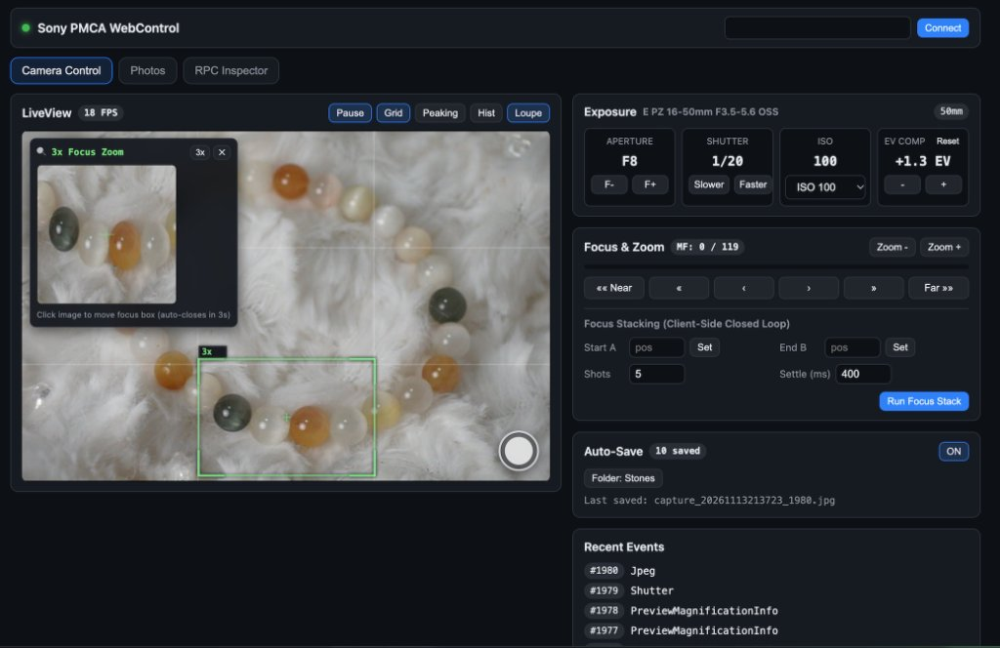

# Sony PMCA WebControl — User Guide (`USER_GUIDE.md`)

This guide covers camera compatibility, flashing the `.apk` to your Sony camera, connecting over Wi-Fi, and using the web control interface.

---

## 1. Compatibility & Hardware Requirements

### Supported Camera Bodies
* **Full Support** (`ScalarProperties.PROP_VERSION_PLATFORM >= 2.3` — Live View, remote MF stepping, automated focus bracketing, and exposure control):
  * **APS-C E-mount**: `ILCE-5100` (a5100), `ILCE-6000` (a6000), `ILCE-6300` (a6300), `ILCE-6500` (a6500)
  * **Full-Frame E-mount**: `ILCE-7M2` (a7 II), `ILCE-7RM2` (a7R II), `ILCE-7SM2` (a7S II), and `ILCE-7` / `ILCE-7R` / `ILCE-7S` updated to the latest firmware
  * **Fixed-Lens Cyber-shot**: `DSC-RX100M3` (RX100 III), `DSC-RX100M4` (RX100 IV), `DSC-RX100M5` (RX100 V), `DSC-RX10M2` (RX10 II), `DSC-RX10M3` (RX10 III), `DSC-RX1RM2` (RX1R II)
* **Partial Support** (`PROP_VERSION_PLATFORM < 2.3` — Live View, exposure, and capture work; motorized focus drive is unavailable in firmware):
  * `NEX-5R`, `NEX-5T`, `NEX-6`, `DSC-RX100M2`
* **Unsupported**:
  * Post-2018 Sony bodies that removed the PlayMemories Android subsystem (`a6100`, `a6400`, `a6600`, `a6700`, `ZV-E10`, `a7 III`, `a7 IV`, etc.).

### Lens, Power & Storage Notes
* **AF Lens Requirement**: Software focus control sends electronic drive commands to the lens focus motor. **An E-mount lens with electronic contacts and an AF motor is required** (including standard AF lenses mounted on electronic AF macro extension tubes). Purely mechanical manual lenses (e.g., Laowa 65mm f/2.8 2X) cannot be focused electronically, though Live View, exposure adjustments, and shutter release still work.
* **Power Management**: The app disables auto power-off (`setAutoPowerOffMode(false)`) while active so the camera does not sleep mid-session. Using an NP-FW50 USB dummy battery is recommended for long studio sessions.
* **Storage**: Full-resolution `.JPG` and `.ARW` files are written to the camera's SD card and can be browsed on demand or auto-saved over Wi-Fi.

---

## 2. Flashing the APK to Your Camera

> **Note:** Sony Alpha cameras do **not** expose standard Android `adb` debugging. Do not use `adb install` — flashing goes through USB MTP mode via [Sony-PMCA-RE (`pmca-console`)](https://github.com/ma1co/Sony-PMCA-RE).

1. **Get the APK**:
   * Download `sony-pmca-webcontrol-debug-1.0.0.apk` from **GitHub Releases** (or build it yourself — see [DEVELOPER_GUIDE.md](./DEVELOPER_GUIDE.md)).
2. **Get `Sony-PMCA-RE` (`pmca-console.py`)**:
   * `tools/` is not bundled in this repository. Either download a prebuilt binary from [Sony-PMCA-RE Releases](https://github.com/ma1co/Sony-PMCA-RE/releases), or clone it and set up a Python virtual environment:
     ```bash
     git clone https://github.com/ma1co/Sony-PMCA-RE.git tools/Sony-PMCA-RE
     python3 -m venv .venv
     .venv/bin/pip install -r tools/Sony-PMCA-RE/requirements.txt
     ```
3. **Connect via USB (MTP / Mass Storage mode)** and power on the camera.
4. **Linux desktop note (`USBError: [Errno 16] Resource busy`)**:
   Desktop environments (GNOME/GVFS) automatically mount MTP devices under `gphoto2://`, preventing `libusb` from claiming the interface. Unmount it first:
   ```bash
   gio mount -l | grep -i gphoto2
   gio mount -u gphoto2://Sony_ILCE-6000_.../
   ```
5. **Install the APK**:
   ```bash
   .venv/bin/python tools/Sony-PMCA-RE/pmca-console.py install -f camera-app/app/build/outputs/apk/sony-pmca-webcontrol-debug-1.0.0.apk
   ```
   Wait until `Task completed successfully` appears, then disconnect the USB cable.

---

## 3. Launching on the Camera

1. Make sure your camera has a saved Wi-Fi network configured (under camera **Network → Access Point Set.**).
2. On the camera: **Menu → Application → Application List → PMCA WebControl**.
3. Wait for the camera to join your Wi-Fi router. The LAN IP address and port (for example, `http://192.168.0.250:8080`) appear at the bottom of the camera screen.

---

## 4. Using the Web Control UI



You can control the camera in two ways:

### Option A: Full React Web Client (`web-client/`)
Open the prebuilt single-file `index.html` (or run `npm run dev` in `web-client/` for HTTPS local development, which is required by browsers for `showDirectoryPicker` auto-save) and connect to your camera's IP:
* **LiveView**: Canvas-based MJPEG stream with client-side **Focus Peaking**, **Rule-of-Thirds Grid**, **Luma Histogram**, and **2x–4x Click-to-Magnify Focus Loupe**. Automatically pauses and notifies the camera to release the stream slot when you switch browser tabs or minimize the window.
* **Exposure & Capture**: Real-time aperture, shutter speed, ISO, EV compensation controls, and remote shutter release.
* **Focus & Stacking**: Multi-speed manual focus stepping, power zoom, and automated closed-loop **Focus Bracketing / Focus Stacking** between `Start A` and `End B`.
* **Auto-Save**: Automatically downloads newly captured photos to a chosen local folder (via File System Access API `showDirectoryPicker`) or falls back to standard browser downloads.
* **Photo Browser**: Browse SD card `DCIM` folders, preview photos, and download `.JPG` / `.ARW` files.
* **RPC Inspector**: Interactive `/api/describe` explorer and `/api/call` tester.

> **Auto-Save Browser Context Note:**
> * Opening the single-file `index.html` directly via `file://` works for LiveView, exposure, focus stacking, and photo browsing (via direct CORS requests to the camera), **except** browsers do not allow `showDirectoryPicker` on `file://` pages — Auto-Save will automatically fall back to standard browser downloads into your default Downloads folder.
> * To save silently into a chosen local folder, open the UI from a secure context: either run `cd web-client && npm run dev` (local HTTPS + `/api` proxy) or serve `dist/index.html` on `http://localhost` (e.g., `python3 -m http.server 8000` inside `web-client/dist/`).

### Option B: Built-in Fallback UI
Opening `http://<camera-ip>:8080` directly in any browser on your LAN serves a lightweight built-in control page (`camera-app/app/src/main/assets/index.html`) with selectable MJPEG/JPG LiveView for quick testing without running `web-client/`.
